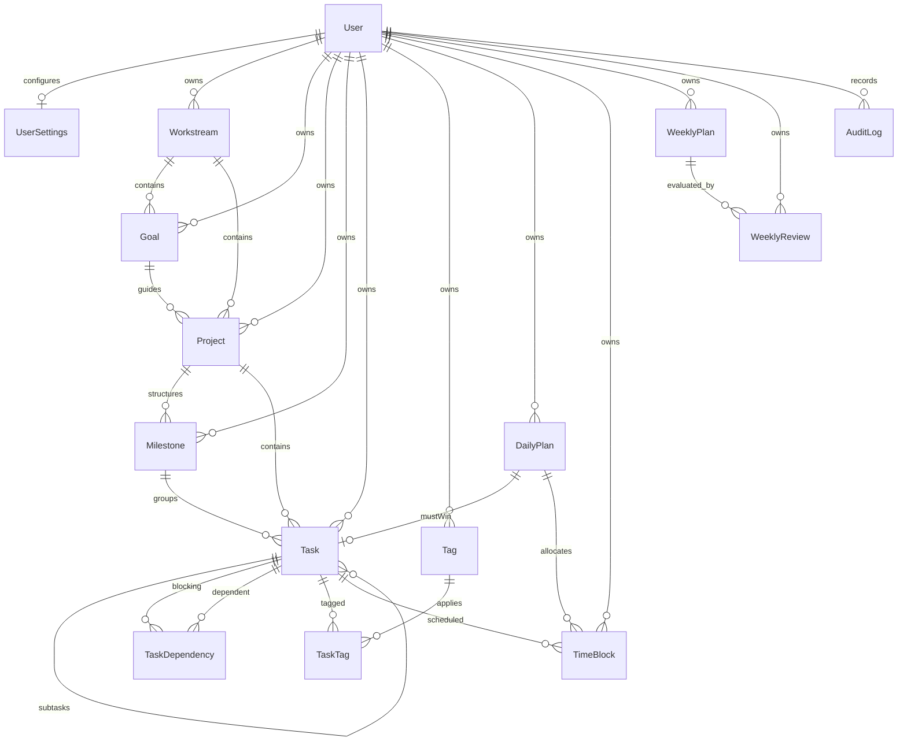

# Data Model & Conceptual ERD — KENENISA OS

This document details the core execution, planning, review, and audit entities established in Step 2.

## Entity Relationship Diagram (ERD)

---

## Core Schema Models

### 1. Identity & Configuration

- **`User`**: System identity (`id`, `email`, `passwordHash`, `role`, `isActive`).
- **`UserSettings`**: Personal preferences (`timezone`, `weekStartsOn`, `dailyWorkCapacityMinutes`, `weeklyWorkCapacityMinutes`).

### 2. Core Execution Hierarchy

- **`Workstream`**: Top-level strategic area (e.g. _ASTU / Graduation_, _Full-Stack Engineering_).
- **`Goal`**: Outcome-oriented target belonging to a Workstream.
- **`Project`**: Discrete project belonging to a Workstream (and optionally a Goal).
- **`Milestone`**: Sequential phase inside a Project.
- **`Task`**: Primary unit of execution (`BACKLOG`, `READY`, `IN_PROGRESS`, `BLOCKED`, `REVIEW`, `DONE`, `CANCELLED`).
- **`TaskDependency`**: Explicit dependency graph connecting blocking and dependent tasks.
- **`Tag` & `TaskTag`**: Flexible tagging model for cross-cutting categorizations.

### 3. Planning & Reflection

- **`DailyPlan`**: Single plan per user per day with optional `mustWinTaskId`.
- **`TimeBlock`**: Focused work period linked to a `DailyPlan` and/or `Task`.
- **`WeeklyPlan`**: Weekly execution strategy (`weekStart`, `weekEnd`, `theme`).
- **`WeeklyReview`**: Reflection on weekly execution (`wins`, `challenges`, `lessons`, `nextFocus`).

### 4. Traceability

- **`AuditLog`**: Audit trail for state transitions (`entityType`, `entityId`, `action`, `metadata`).
