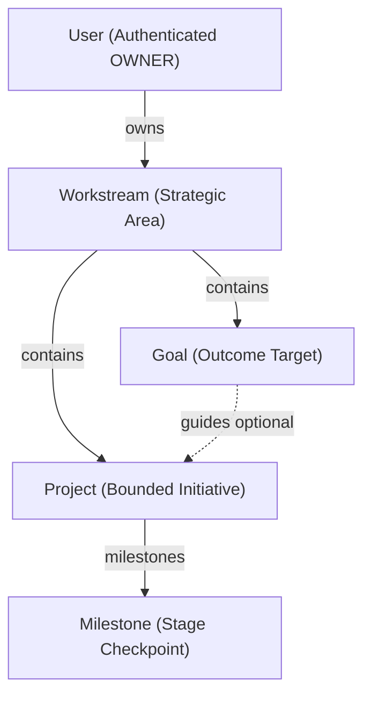

# System Overview — KENENISA OS

KENENISA OS is a personal Engineering & Career Operating System designed to manage 5th-year ASTU academic work, final projects, full-stack & AI engineering learning, EDOT SaaS product development, freelancing, personal branding, and productivity analytics.

```
                  ┌──────────────────────────────┐
                  │    KENENISA OS Web Client    │
                  │ (React 19 + Vite + Tailwind) │
                  └──────────────┬───────────────┘
                                 │ HTTP / REST (/api/v1)
                                 ▼
                  ┌──────────────────────────────┐
                  │     Express 4 REST API       │
                  │  (Helmet, RateLimit, Pino)   │
                  └──────────────┬───────────────┘
                                 │ Prisma ORM
                                 ▼
                  ┌──────────────────────────────┐
                  │      PostgreSQL Database     │
                  └──────────────────────────────┘
```

## Strategic Hierarchy Model



## Workspaces

- `apps/web`: Single Page Application frontend
- `apps/api`: Express REST API backend
- `packages/shared`: Shared types, constants, schemas, and contracts
