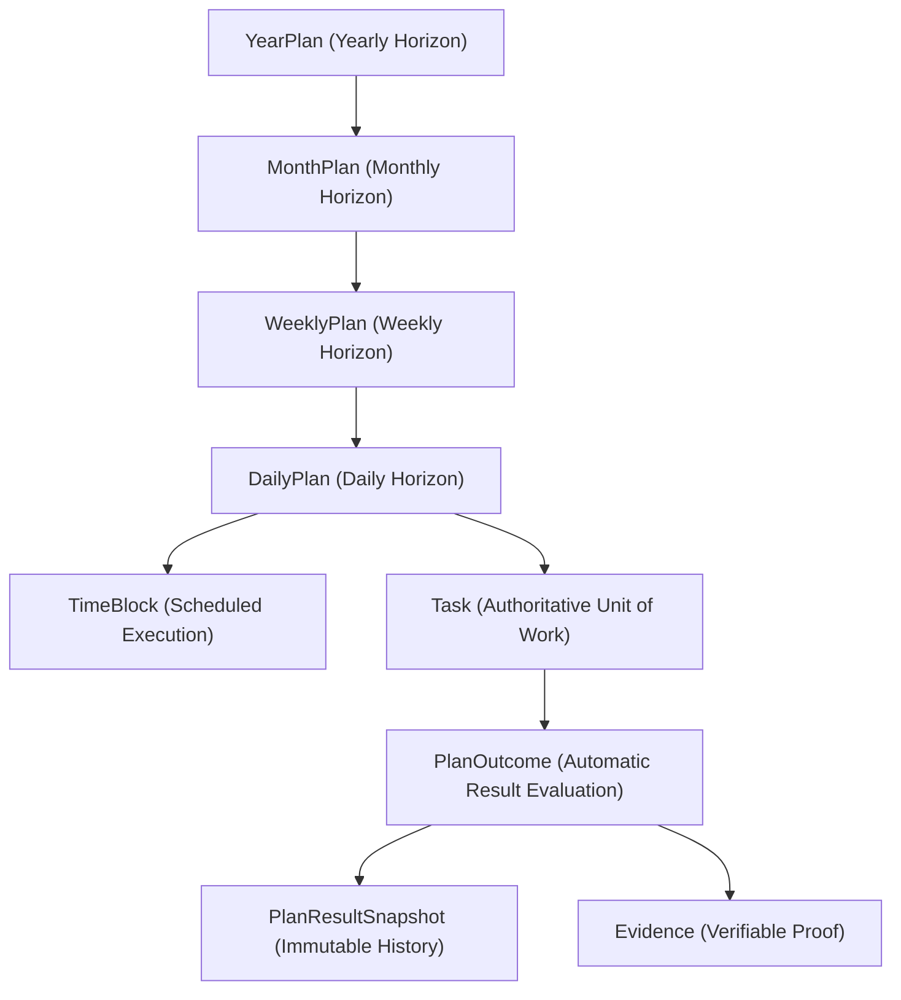

# Multi-Horizon Planning Architecture & Execution Model

ID: `PLAN-001`
Status: `APPROVED`

## Overview
KENENISA OS Multi-Horizon Planning structures execution across four nested time horizons:
1. **Yearly Horizon (`YearPlan`)**: Long-term strategic direction, annual vision, and key yearly milestones.
2. **Monthly Horizon (`MonthPlan`)**: Mid-term operational objectives, monthly milestones, and capacity allocations.
3. **Weekly Horizon (`WeeklyPlan`)**: Short-term tactical themes, weekly workload targets, and day-by-day capacity breakdown.
4. **Daily Horizon (`DailyPlan`)**: Micro-execution schedule, primary must-win objective, time blocks, and task execution.

## Key Entities & Schema
- `YearPlan`: Unique per `(userId, year)`. Links optional `Workstream`, `Goal`, `Project`.
- `MonthPlan`: Unique per `(userId, year, month)`. Links to parent `YearPlan`.
- `WeeklyPlan`: Unique per `(userId, weekStart)`. Links to parent `MonthPlan`.
- `DailyPlan`: Unique per `(userId, date)`. Links to parent `WeeklyPlan`.
- `PlanOutcome`: Normalized planned outcome across any horizon with states (`PLANNED`, `IN_PROGRESS`, `COMPLETED`, `PARTIALLY_COMPLETED`, `MISSED`, `CANCELLED`, `RESCHEDULED`, `BLOCKED`, `UNKNOWN`).

## Integration
- Integrated with Command Center (`/api/v1/planning/overview`) and Next Best Action Engine.
- Integrated with Evidence Engine via `PlanOutcomeEvidence` (`PLANNED`, `OBSERVED`, `VERIFIED`).
