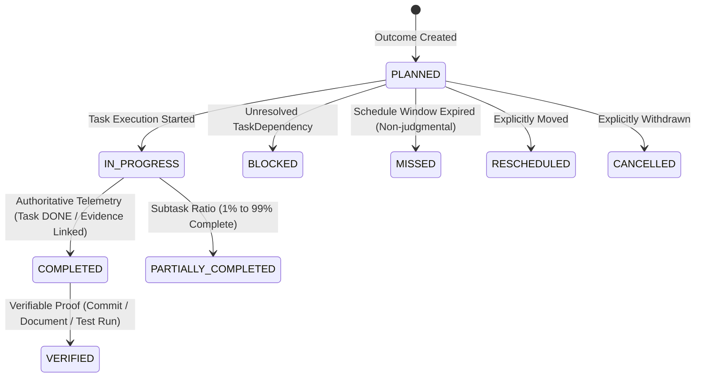

# KENENISA OS — Result Intelligence & Outcome Lifecycle Architecture

ID: `RES-001`  
Status: `APPROVED`

## Overview

The Result Intelligence engine inspects authoritative system telemetries to evaluate outcome states, track lifecycle histories, and detect non-judgmental execution patterns across all four planning horizons (**Yearly**, **Monthly**, **Weekly**, **Daily**).

---

## 1. Outcome Lifecycle States

Every outcome preserves an auditable lifecycle history:

---

## 2. Telemetry Telemetry Result Sources

Result sources indicate how outcome conclusions are derived:

| Result Source | Description |
| :--- | :--- |
| `AUTOMATIC` | Derived deterministically by the evaluation engine from task/subtask telemetries. |
| `USER_CONFIRMED` | Manually confirmed or adjusted by the user with audit notes. |
| `SYSTEM_VERIFIED` | Backed by verifiable external or internal evidence artifacts (Git commits, test runs, submitted work). |
| `UNKNOWN` | System lacks sufficient telemetry to make a non-guessing determination. |

---

## 3. Pattern Detection Engine

The engine identifies 4 categories of execution patterns:
1. `RESCHEDULE_RECURRENCE`: Identifies planned activities rescheduled multiple times.
2. `BLOCKER_RECURRENCE`: Identifies tasks blocked repeatedly by the same upstream dependency.
3. `WEEKDAY_CONCENTRATION`: Identifies specific weekdays with elevated missed/unresolved rates.
4. `CAPACITY_OVERLOAD`: Identifies periods where scheduled time exceeded available capacity.
